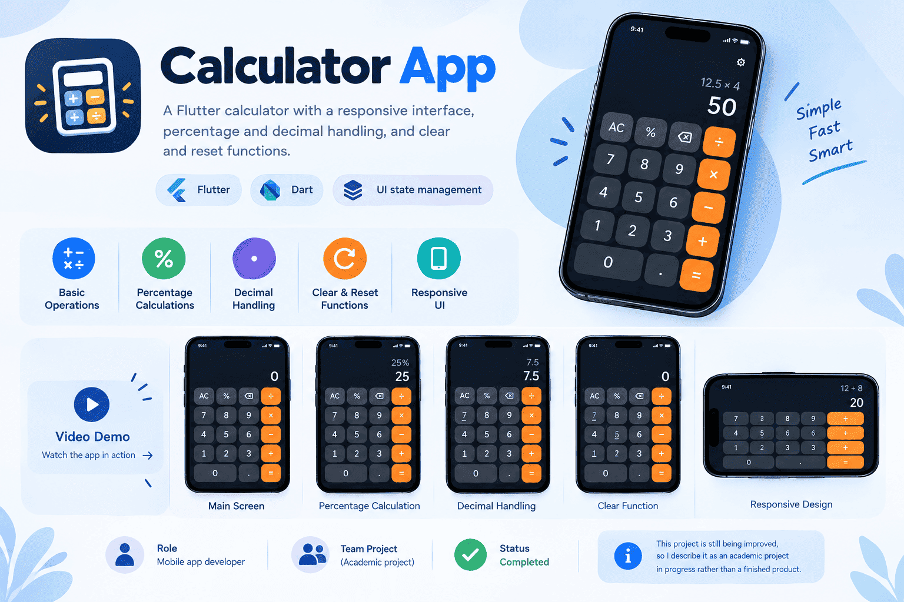

# Simple Calculator

## Overview

A Flutter calculator with a responsive interface. It handles input as you type and updates the displayed result.



## Features

- Basic arithmetic operations
- Percentage calculations
- Decimal handling
- Clear and reset functions
- Responsive layout

## Font
Antic Didone, licensed under the SIL Open Font License.

## Built with

Flutter · Dart · UI state management for input and result display

## Run it

```bash
flutter pub get
flutter run
```

Requires the [Flutter SDK](https://docs.flutter.dev/get-started/install).

## Author

Ahmed Ibrahim Mohamed Kamel · [GitHub](https://github.com/AhmedShosha3) · [LinkedIn](https://www.linkedin.com/in/ahmed-shosha-212192296/)
